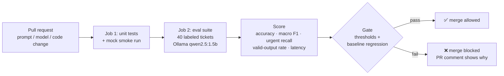

# LLM Eval Gate: regression testing + CI quality gate for a ticket triage agent

A containerized evaluation pipeline that runs a labeled test suite against an LLM support-ticket
triage agent, scores the results, and **blocks a pull request from merging** when quality drops
below a threshold or regresses against the last accepted baseline.

It runs entirely on free tools: a small open-source model served by [Ollama](https://ollama.com),
Docker, and GitHub Actions (free for public repositories). No API keys are required.



## What it measures

| Metric | Meaning | Default gate |
|---|---|---|
| `category_accuracy` | Share of tickets put in the right category | ≥ 0.70 |
| `category_macro_f1` | F1 averaged over the 5 categories, so small classes count equally | ≥ 0.65 |
| `priority_accuracy` | Exact priority match (Low / Medium / High / Critical) | ≥ 0.45 |
| `urgent_recall` | Of truly High/Critical tickets, share the agent flagged as High/Critical. Missing an urgent ticket is the costliest error. | ≥ 0.60 |
| `valid_output_rate` | Share of outputs that parsed into allowed labels | ≥ 0.95 |
| `latency_p95_s` | 95th-percentile response time | ≤ 30 s |

Also reported, not gated: `priority_within_one`, `latency_p50_s`, per-class precision/recall/F1 and a
confusion matrix.

**Regression check:** each tracked metric may drop at most **0.05** below the committed baseline in
`baseline/baseline_metrics.json`. Baselines are only compared when the model matches.

All thresholds live in `config/eval_config.yaml`, so changing the bar is itself a reviewed change.

## Project layout

```
.github/workflows/eval-gate.yml   CI: unit tests -> eval suite -> PR comment -> gate
config/eval_config.yaml           provider, labels, thresholds, regression settings
data/golden_set.jsonl             40 hand-labeled tickets (8 per category)
prompts/triage_v1.txt             production prompt
prompts/triage_v0_bad.txt         deliberately weak prompt, for demoing a failing gate
baseline/baseline_metrics.json    last accepted metrics (created by you, see step 4)
src/evalgate/
  providers.py    mock | ollama | gemini | http (your Project 2 FastAPI service)
  triage.py       prompt building + robust JSON / label parsing
  metrics.py      accuracy, macro F1, urgent recall, latency percentiles, confusion matrix
  gate.py         threshold + regression checks
  report.py       metrics.json, predictions.csv, summary.md (PR comment), report.html, history.jsonl
  cli.py          `python -m evalgate run | promote`
tests/            20 pytest tests, no model needed
Dockerfile, docker-compose.yml    containerized runner + Ollama
```

## Quick start (local)

Requires Python 3.10+.

```bash
python -m venv .venv
source .venv/bin/activate          # Windows: .venv\Scripts\activate
pip install -e ".[dev]"

pytest -q                                   # 20 tests, under a second
python -m evalgate run --provider mock      # full pipeline with a keyword-rule stand-in model
```

Open `reports/report.html` in a browser to see the results.

### With a real local model (free)

1. Install Ollama from https://ollama.com/download
2. In a terminal:
   ```bash
   ollama pull qwen2.5:1.5b        # ~1 GB download, runs on CPU with ~4 GB RAM free
   python -m evalgate run          # provider defaults to ollama
   ```
   On a typical laptop CPU, 40 cases take 2-6 minutes.

### Fully containerized

```bash
docker compose up --build --abort-on-container-exit --exit-code-from evalgate
```

This starts Ollama, downloads the model, runs the suite, and writes reports to `./reports`.
The command exits non-zero if the gate fails, just like CI.

## Commands

| Command | What it does |
|---|---|
| `python -m evalgate run` | Run suite with the configured provider, apply gate, exit 1 on failure |
| `... run --provider mock` | Deterministic no-model run |
| `... run --prompt prompts/triage_v0_bad.txt` | Try a different prompt |
| `... run --limit 5` | Quick check on the first 5 cases |
| `... run --update-baseline` | Save this run as the new baseline |
| `... run --no-fail` | Report only, always exit 0 |
| `python -m evalgate promote reports/metrics.json` | Make a downloaded CI run the baseline |

Makefile shortcuts: `make test`, `make eval-mock`, `make eval`, `make eval-bad`, `make baseline`, `make docker-eval`.

## Testing your own Project 2 agent

The default flow tests a prompt against a model directly. To test your deployed FastAPI triage
service instead, start it and run:

```bash
HTTP_AGENT_URL=http://localhost:8000/triage python -m evalgate run --provider http
```

Contract: `POST {"subject": "...", "description": "..."}` returns
`{"category": "...", "priority": "..."}` using the labels in `config/eval_config.yaml`.

To use Google Gemini's free tier instead of Ollama, set `GEMINI_API_KEY` and run
`--provider gemini`. Calls are throttled to stay within free-tier rate limits.

## Demo: watch the gate block a bad change

1. Create a branch and point the config at the weak prompt:
   ```bash
   git checkout -b try-shorter-prompt
   # in config/eval_config.yaml:  prompt: prompts/triage_v0_bad.txt
   git commit -am "Try a shorter prompt" && git push -u origin try-shorter-prompt
   ```
2. Open a pull request. The `llm-eval-gate` check fails, and the bot comment shows which metrics
   dropped and which tickets were misclassified.
3. Close the PR without merging.

## Design decisions

- **Golden set, not live traffic.** A fixed, labeled set makes runs comparable over time. Add a case
  every time you find a real failure, so it can never come back unnoticed.
- **Thresholds plus baseline.** Thresholds set a minimum quality bar. The baseline catches slow drift
  that would still pass the bar.
- **Urgent recall is gated separately.** Under-prioritizing a security or safety ticket costs far more
  than over-prioritizing a how-to question, and overall accuracy hides that.
- **Temperature 0 and a fixed seed** keep runs as repeatable as possible. The 0.05 tolerance absorbs
  small CPU-level nondeterminism.
- **Invalid output counts as wrong.** A response the downstream system can't parse is a failure,
  not a skipped case.
- **Small model in CI.** `qwen2.5:1.5b` keeps runs fast and free on GitHub's CPU runners. Swap
  `OLLAMA_MODEL` for a larger model locally to compare.

## Ideas to extend

- Add adversarial / prompt-injection tickets as a second suite with its own threshold
- Compare two models or two prompt versions side by side in one report
- Track `reports/history.jsonl` over time in a small dashboard
